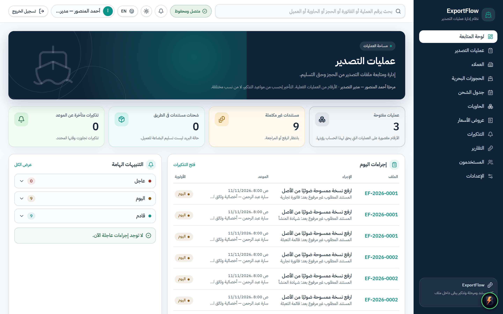
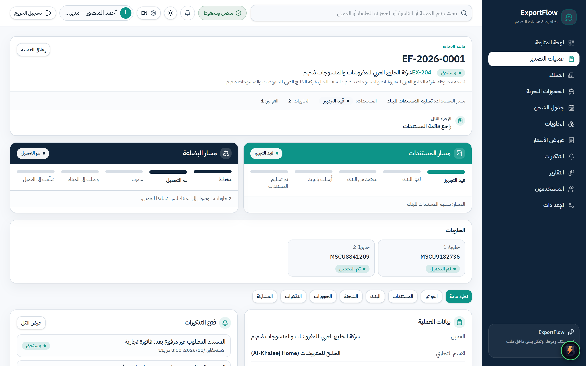
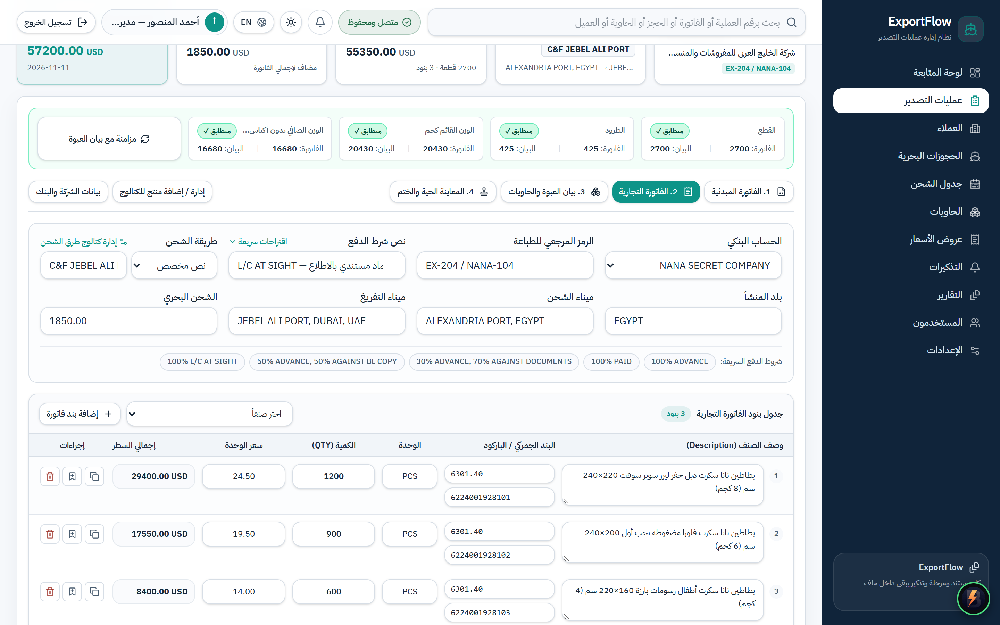
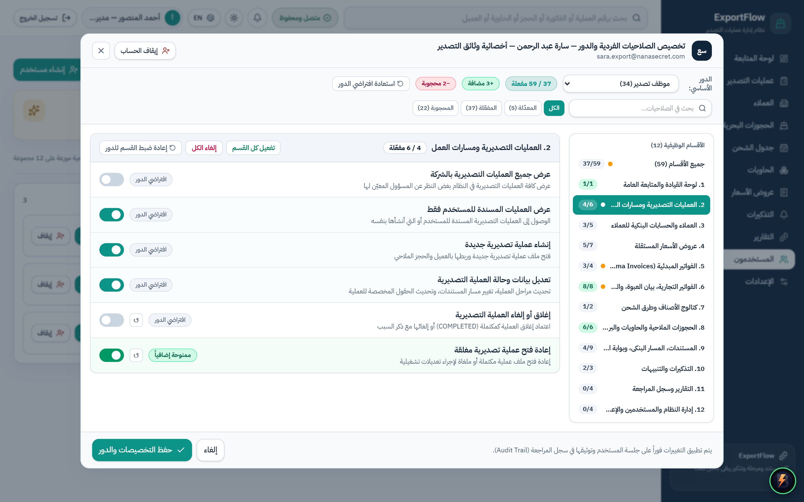
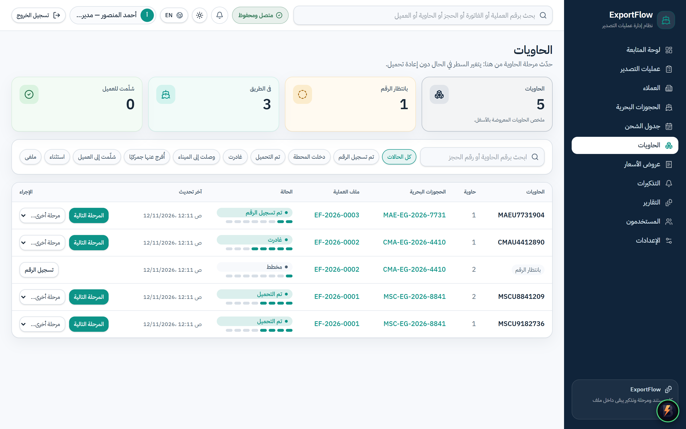
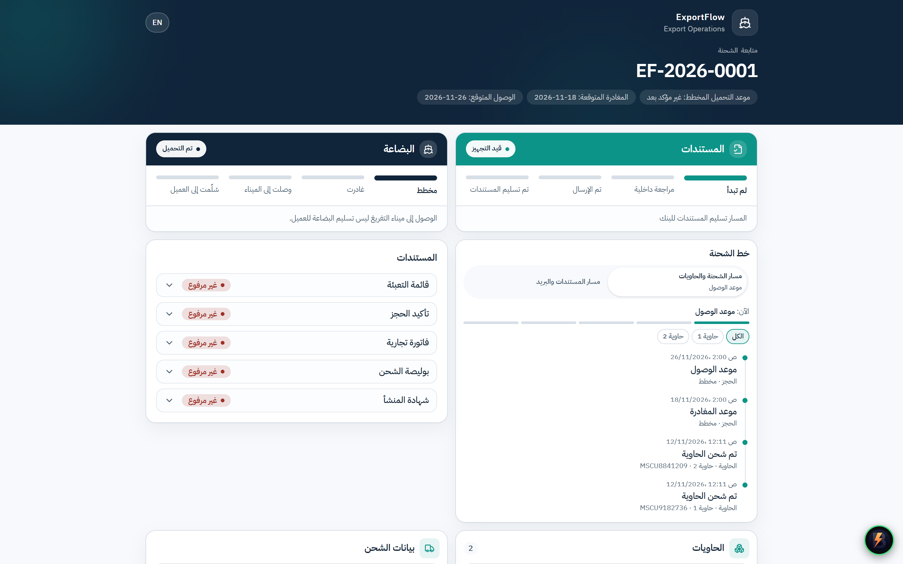
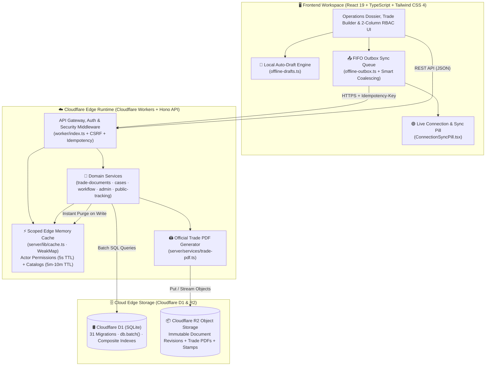

<div align="center" dir="ltr">

[](./README.md)
[](./README.en.md)

**[🇸🇦 العربية](./README.md)** | **[🇬🇧 English (Active)](./README.en.md)**

---

# 🚢 ExportFlow (`InjazDocs`)
### Cloud-Edge Export Operations, Trade Documentation, Customs Reconciliation & Logistics Platform

[](https://workers.cloudflare.com/)
[](https://developers.cloudflare.com/d1/)
[](https://developers.cloudflare.com/r2/)
[](https://react.dev/)
[](https://www.typescriptlang.org/)
[](https://tailwindcss.com/)
[](https://orm.drizzle.team/)
[](https://vitest.dev/)

---

**ExportFlow (`InjazDocs`)** is a full-stack enterprise export operations and international trade documentation platform engineered for exporters, logistics teams, and trade compliance departments. Running natively on the Cloudflare Edge (`Workers + D1 + R2`), it orchestrates the entire shipment lifecycle—from **Proforma Invoices**, **Commercial Invoices (`CI`)**, and **Containerized Packing Lists (`PL`)** with **Live Customs Reconciliation**, to **Bank L/C Submission Pre-Checks** and a **Public Importer Tracking Portal**—backed by **Offline-First Resilience** and a **59-Permission Hybrid RBAC Matrix**.

</div>

---

## 📸 Visual Tour & Real High-DPI Screenshots

### 1. Executive Operations Dashboard (`/dashboard`)

> **Real-Time Operational Command Center:** Displays active export cases, port cutoff countdowns, document readiness indicators, shipping line bookings, and daily operational reminders in a native bilingual (`RTL/LTR`) workspace.

---

### 2. Unified Export Case Dossier Workspace (`/export-cases/:id`)

> **End-to-End Case Dossier:** Consolidates the dual-lane progress tracker (Documents vs. Cargo), ocean bookings, container allocations, required export certificates, review workflows, and bank submission readiness into a single workspace.

---

### 3. Unified Trade Documents Builder & Live Customs Reconciliation (`TradeBuilder`)

> **Commercial Invoice, Packing List & Interactive Digital Stamp:** Converts Proforma Invoices into Commercial Invoices (`CI`) and Packing Lists (`PL`) in one click, featuring a **Live Customs Reconciliation Bar** that continuously verifies piece counts, packages, gross weights, and net weights across containers, alongside a live `A4` print preview with a draggable/rotatable official stamp and `Cloudflare R2` PDF archiving.

---

### 4. 59-Permission Hybrid RBAC Matrix (`2-Column Master-Detail UI`)

> **Granular Role & Per-User Access Control:** Built with a Linear/Stripe-inspired **2-Column Master-Detail Layout** and **Smart Toggle Switches**, allowing administrators to manage **59 granular permissions** across **12 functional groups** and apply per-user explicit grants (`+Grant`) or restrictions (`-Deny`) on top of role templates.

---

### 5. Containers & Logistics Operations (`/containers`)

> **Container Lifecycle & Ocean Freight Tracking:** Tracks container state transitions (`PLANNED` -> `NUMBER_ASSIGNED` -> `GATED_IN` -> `LOADED` -> `DEPARTED` -> `ARRIVED_PORT` -> `CUSTOMS_RELEASED` -> `DELIVERED`), ISO 6346 container numbers, shipping lines, and `ETD / ETA` schedules.

---

### 6. Public Importer Tracking Portal (`/track/:token`)

> **External Importer Transparency:** Shareable, token-guarded public tracking portal displaying a dual timeline for cargo milestones and trade document readiness without requiring internal user credentials.

---

## ✨ Key Enterprise Features

### 🧾 1. Unified Trade Documents, Packing List & Customs Reconciliation Engine
- **Connected Document Lifecycle:** Author **Proforma Invoices**, track buyer acceptance, and convert them into linked **Commercial Invoices (`CI`)** and **Packing Lists (`PL`)** inside the export case dossier.
- **Live Customs Reconciliation:** Real-time verification comparing total Commercial Invoice quantities against Packing List package counts, net weights, and gross weights across assigned containers—preventing customs discrepancies before final issuance.
- **Interactive Digital Stamp & R2 PDF Archiving:** Automatic bilingual amount-in-words (`Tafqeet`), interactive official company stamp & signature positioning (`X/Y ratio, scale, rotation`), and server-side generation of immutable `PDF` revisions archived in **Cloudflare R2**.
- **Customizable Print Templates & Exporter Bank Accounts:** Per-column visibility toggles, custom header labels, dynamic custom fields, and multi-bank `IBAN / SWIFT` profiles.

### 🛡️ 2. 59-Permission Hybrid RBAC Matrix
- **59 Granular Permissions Across 12 Functional Groups:** Covers Export Cases, Proformas, Commercial Invoices, Packing Lists, Containers, Bookings, Documents, Bank Submissions, Customers, Catalogs, Reports, and System Administration.
- **Server-Enforced Hybrid Resolution Formula:**
  $$\text{Effective Permissions} = (\text{Role Permissions} \cup \text{Explicit Grants}) \setminus \text{Explicit Denies}$$
- **2-Column Master-Detail Customizer UI:** Interactive category sidebar, smart toggle switches, live effective/override counters (`+Grants` / `-Denies`), and one-click reset to role defaults.

### ⚡ 3. Scoped Edge In-Memory Caching & D1 Batch Optimization
- **D1 Query Batching (`db.batch`):** Consolidates multi-table reads across export case dossiers and trade sheets into single round-trip batch executions, eliminating `N+1` query bottlenecks.
- **Isolate-Safe Scoped Edge Cache (`WeakMap<D1Database, ScopedStore>`):** Caches resolved actor permissions (`5s TTL`) and reference catalogs (`5m–10m TTL`) per database binding with **instant selective prefix invalidation on write**.
- **Composite SQLite Indexes (`31 Drizzle Migrations`):** Purpose-built composite indexes optimizing invoice lines, packing lines, case status filters, document reviews, and bank submissions.

### 🌐 4. Offline-First Auto-Draft & FIFO Outbox Sync Engine
- **Local Auto-Draft Persistence:** Automatically persists unsaved Commercial Invoice and Packing List edits in `localStorage` with an instant recovery banner upon returning to the dossier.
- **FIFO Outbox Queue & Smart Coalescing:** Intercepts write mutations during network drops, coalesces sequential edits targeting the same invoice resource, and replays queued mutations in strict `FIFO` order upon reconnection using `Idempotency-Key` headers and `navigator.locks` cross-tab coordination.

### 🏦 5. Bank Submission Pre-Check & Public Importer Tracking Portal
- **Automated Bank Pre-Check Engine:** Validates mandatory trade documents and customs reconciliation status prior to bank submission to prevent Letter of Credit (`L/C`) discrepancies.
- **Public Importer Tracking Portal:** Cryptographically hashed (`SHA-256`) public tracking links with granular field-visibility scopes, instant revocation, and token rotation.

---

## 🏗️ System Architecture



---

## 📂 Repository Directory Structure

```text
InjazDocs/
├── worker/                         # Cloudflare Worker entry point (fetch & scheduled handlers)
│   └── index.ts                    # Request routing, session handling, and scheduled cron jobs
├── shared/                         # Shared contracts between Edge Backend & React Frontend
│   ├── permissions.ts              # 59 granular permissions, 12 groups, and default role matrices
│   ├── schemas.ts                  # Strict Zod validation schemas for all API payloads
│   └── types.ts                    # Shared TypeScript domain interfaces
├── server/                         # Edge Backend Domain & Data Layer
│   ├── db/
│   │   └── schema.ts               # Drizzle ORM SQLite table definitions
│   ├── lib/
│   │   ├── cache.ts                # Scoped Edge cache (WeakMap<D1Database> + TTL + Prefix Purge)
│   │   ├── crypto.ts               # PBKDF2 password hashing & SHA-256 token hashing
│   │   └── http.ts                 # Standardized HTTP responses & error envelopes
│   └── services/
│       ├── actor.ts                # Hybrid RBAC resolver (Role ∪ Grants \ Denies) with 5s cache
│       ├── trade-documents.ts      # Proformas, Commercial Invoices, Packing Lists & Reconciliation
│       ├── trade-pdf.ts            # Official A4 PDF generation & R2 archiving
│       ├── cases.ts                # Export cases, bookings, containers, and audit logs
│       ├── workflow.ts             # Workflow transitions, bank pre-check, and reminder rules
│       ├── admin.ts                # Users, role templates, permission overrides, and backups
│       └── public-tracking.ts      # Public importer tracking portal & dual timeline service
├── src/                            # React 19 Frontend Application (RTL/LTR)
│   ├── components/
│   │   ├── layout/                 # Application shell, top bar, and ConnectionSyncPill
│   │   └── ui/                     # Reusable design system primitives
│   ├── features/
│   │   ├── dashboard/              # Executive operations dashboard
│   │   ├── cases/                  # Export case dossier, TradeBuilder, and interactive stamp
│   │   ├── admin/                  # 2-Column RBAC permission customizer, users & catalogs
│   │   ├── operations/             # Bookings, containers, customers, and operational reports
│   │   └── public/                 # Public importer tracking page
│   └── lib/
│       ├── api.ts                  # Unified API client integrated with the offline outbox
│       ├── offline-drafts.ts       # Local auto-draft storage & recovery engine
│       └── offline-outbox.ts       # FIFO outbox sync queue (Smart Coalescing + Web Locks)
├── drizzle/
│   └── migrations/                 # 31 sequential SQL migrations (0001 to 0031) for Cloudflare D1
├── tests/                          # Automated test suite (40 test files · 201 passed tests)
├── e2e/                            # End-to-End Playwright browser test suite
├── scripts/                        # Isolated build guards, seeding utilities, and E2E harnesses
├── docs/                           # Canonical reference documentation & real screenshots (screenshots/)
├── wrangler.jsonc                  # Cloudflare Workers bindings & environment configuration
└── package.json                    # Dependencies and build/test/deployment scripts
```

---

## 🚀 Quick Start, Testing & Production Deployment

### 1. Prerequisites
- **Node.js** `20.x` or later.
- **npm** or **pnpm** package manager.
- **Cloudflare Account** (for remote deployment to `Cloudflare Workers / D1 / R2`).

### 2. Local Environment Setup
```bash
# 1. Install dependencies
npm install

# 2. Create local Worker secrets file from template
cp .dev.vars.example .dev.vars

# 3. Apply all 31 D1 SQLite migrations locally
npm run db:migrate:local

# 4. Seed reference lookup catalogs
npm run seed:lookups
```

### 3. Run Local Development Server
```bash
# Start Vite + Cloudflare Worker runtime locally on http://127.0.0.1:43173
npm run dev
```

### 4. Engineering Verification & Automated Tests
```bash
# 1. Strict TypeScript typecheck across client, worker, and shared packages
npx tsc -b --pretty false

# 2. Run the full Vitest unit & integration suite (40 test files / 201 tests)
npx vitest run

# 3. Build production client & worker bundles with secret-leak guard
npx cross-env CLOUDFLARE_ENV=production npm run build
```

### 5. Production Deployment to Cloudflare Edge
```bash
# 1. Apply pending migrations to the remote production D1 database
npx wrangler d1 migrations apply exportflow-production --remote --env production

# 2. Build clean production bundle
npx cross-env CLOUDFLARE_ENV=production npm run build

# 3. Deploy Worker & static assets to Cloudflare Workers production
npx wrangler deploy --env production
```

---

## 🔒 Security & Reliability Invariants
1. **100% Server-Enforced Authorization:** Every API route enforces effective permissions server-side via `requirePermission`; UI visibility never substitutes for backend authorization.
2. **Hardened Session & Request Security:** Authenticated via `HttpOnly` session cookies, strict `CSRF` origin validation, and `PBKDF2-SHA256` password hashing.
3. **Idempotent Financial & Document Mutations:** All offline outbox replays and critical POST/PUT requests carry an `Idempotency-Key` header backed by durable D1 witness records to prevent duplicate invoices or state transitions.
4. **Immutable Audit Trail:** All document issuances, status transitions, and permission overrides are recorded in an append-only audit log with actor and timestamp attribution.
