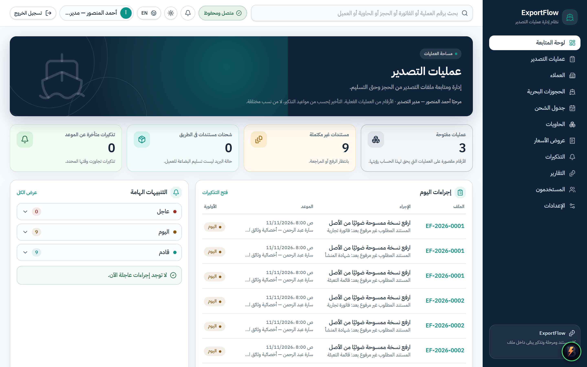
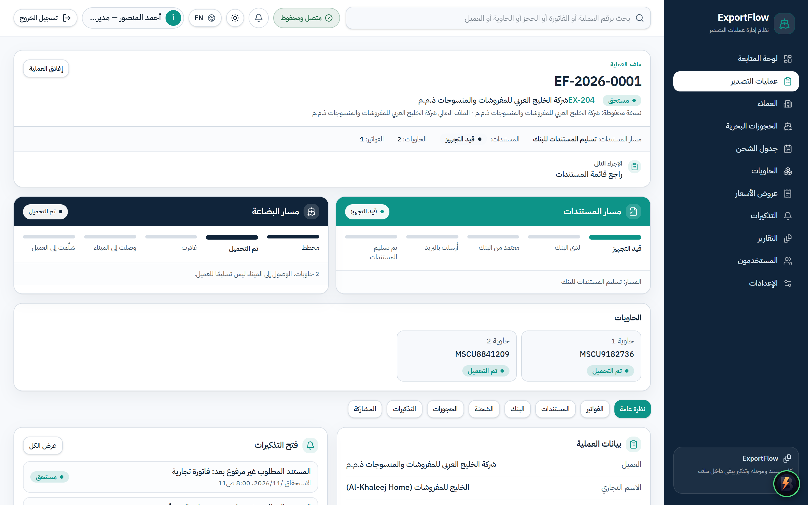
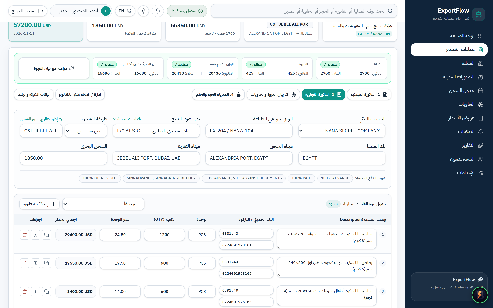
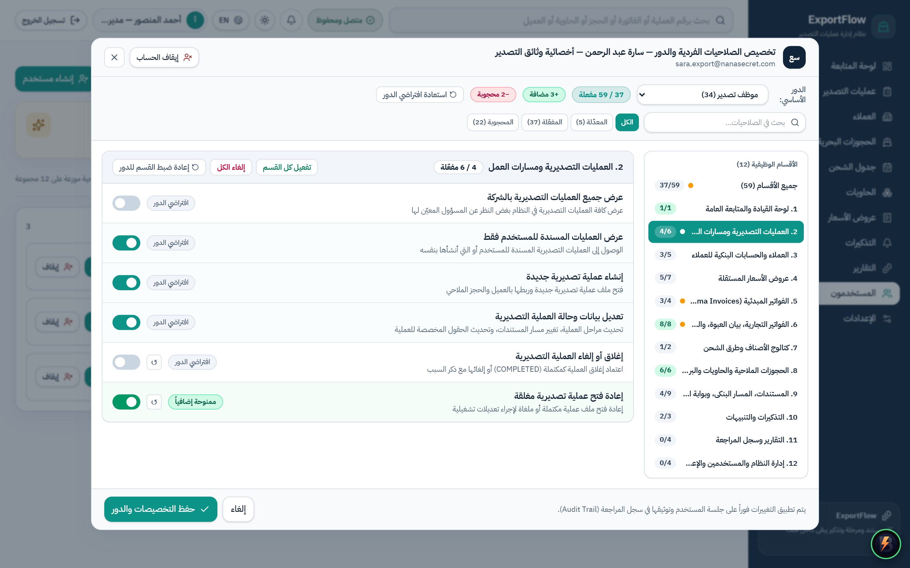
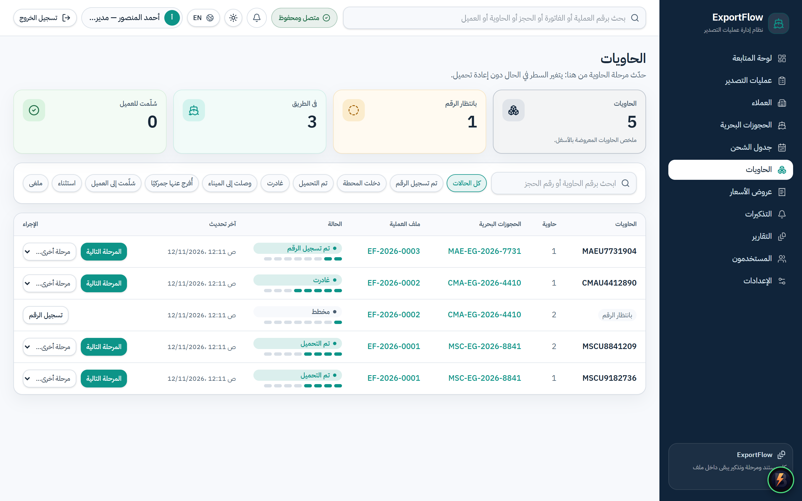
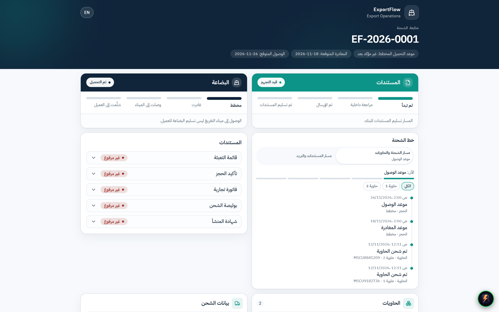
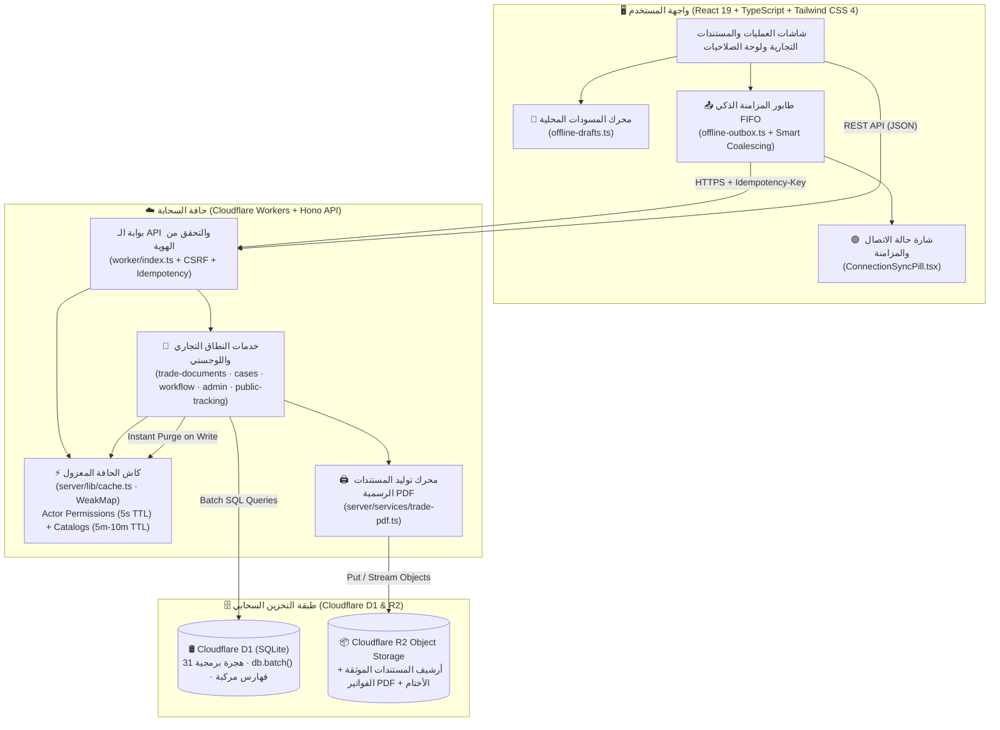

<div align="center" dir="rtl">

# 🚢 ExportFlow (`InjazDocs`)
### منصة إدارة عمليات التصدير، المستندات التجارية الجمركية، والمطابقة البنكية واللوجستية على الحافة السحابية

[](https://workers.cloudflare.com/)
[](https://developers.cloudflare.com/d1/)
[](https://developers.cloudflare.com/r2/)
[](https://react.dev/)
[](https://www.typescriptlang.org/)
[](https://tailwindcss.com/)
[](https://orm.drizzle.team/)
[](https://vitest.dev/)

---

**ExportFlow (`InjazDocs`)** هو نظام مؤسسي متكامل (Enterprise Export Operations & Trade Documentation Platform) صُمّم خصيصاً لشركات التصدير وإدارات العمليات اللوجستية والتجارة الدولية لإدارة دورة حياة الشحنة بالكامل: بدءاً من **عروض الأسعار المبدئية (`Proforma Invoices`)**، ومروراً بـ **الفواتير التجارية (`Commercial Invoices`)** و**بيانات العبوة والحاويات (`Packing Lists`)** و**المطابقة الجمركية والبنكية الآلية**، وصولاً إلى **بوابة تتبع المستورد العامة (`Public Importer Tracking Portal`)**، مع دعم كامل للعمل دون اتصال بالإنترنت (`Offline-First Resilience`) ونظام صلاحيات هجين دقيق يضم **59 صلاحية تشغيلية**.

</div>

---

## 📸 جولة بصرية في شاشات النظام (`Screenshots & Visual Tour`)

### 1. لوحة المتابعة التنفيذية ومؤشرات العمليات (`Executive Operations Dashboard`)

> **لوحة القيادة الفورية:** تعرض مؤشرات الأداء التشغيلية، الشحنات الحرجة، جاهزية المستندات، مواعيد قطع الميناء (`Port Cutoff`)، وتنبيهات المتابعة اليومية في واجهة عربية ثنائية الاتجاه (`RTL/LTR`).

---

### 2. مساحة عمل ملف التصدير الموحدة (`Export Case Dossier Workspace`)

> **ملف التصدير الشامل (`Case Dossier`):** يجمع بيانات الشحنة، الحجوزات الملاحية، المستندات المطلوبة، حالات المراجعة والاعتماد، والفحص المسبق للتقديم البنكي في شاشة تشغيلية واحدة.

---

### 3. محرك المستندات التجارية الموحد والمطابقة الجمركية الحية (`Trade Documents & Customs Reconciliation Engine`)

> **بناء الفواتير وبيان العبوة والختم التفاعلي:** يدعم إنشاء عروض الأسعار (`Proforma`) وتحويلها بضغطة واحدة إلى فاتورة تجارية (`CI`) وبيان عبوة (`PL`)، مع **محرك مطابقة جمركية حي** يقارن الكميات والأوزان الصافية والقائمة الموزعة على الحاويات لحظياً، ومعاينة طباعة حية (`A4`) مع ختم وتوقيع قابلين للتحريك والتدوير وتوليد `PDF` رسمي يُحفظ في `Cloudflare R2`.

---

### 4. منظومة الصلاحيات الهجينة بتخطيط العمودين (`Hybrid RBAC — 59 Granular Permissions`)

> **تحكم دقيق على مستوى المستخدم والدور:** واجهة تفاعلية بتخطيط العمودين (`2-Column Master-Detail Layout`) ومفاتيح تفعيل ذكية (`Toggle Switches`) تتيح إدارة **59 صلاحية دقيقة** موزعة على **12 مجموعة وظيفية**، مع إمكانية منح صلاحيات إضافية (`+Grant`) أو حظر صلاحيات محددة (`-Deny`) لكل مستخدم بشكل مستقل عن دوره الوظيفي.

---

### 5. إدارة الحاويات والعمليات اللوجستية (`Containers & Logistics Operations`)

> **إدارة الحاويات والحجوزات الملاحية:** متابعة حالات الحاويات (`PLANNED` -> `NUMBER_ASSIGNED` -> `GATED_IN` -> `LOADED` -> `DEPARTED`)، أرقام الحاويات القياسية (`ISO 6346`)، خطوط الملاحة، ومواعيد الإبحار والوصول (`ETD / ETA`).

---

### 6. بوابة تتبع المستورد العامة والخط الزمني المزدوج (`Public Importer Tracking Portal`)

> **شفافية كاملة من المستودع إلى ميناء الوصول:** رابط تتبع خارجي آمن للمستورد يعرض الخط الزمني المزدوج للمستندات والحاويات وحالة الاعتماد البنكي أو الشحن المباشر دون الحاجة لحساب داخلي.

---

## ✨ أبرز المميزات الهندسية والتشغيلية (`Key Enterprise Features`)

### 🧾 1. محرك المستندات التجارية وبيان العبوة (`Trade Documents Engine`)
- **دورة مستندية مترابطة:** إنشاء عروض الأسعار (`Proforma Invoices`)، اعتمادها، وتحويلها آلياً إلى فاتورة تجارية (`Commercial Invoice`) وبيان عبوة (`Packing List`) مرتبطين بملف التصدير.
- **المطابقة الجمركية اللحظية (`Live Customs Reconciliation`):** مقارنة آلية بين إجمالي كميات البنود في الفاتورة التجارية ومجموع العبوات والأوزان الصافية والقائمة (`Net / Gross Weight`) الموزعة على الحاويات، مع منع الإصدار النهائي عند وجود تضارب جمركي.
- **التفقيط الآلي والختم التفاعلي:** تفقيط المبالغ المالية تلقائياً بالعربية والإنجليزية، ورفع صورة الختم والتوقيع الرسمي مع التحكم بموضعهما (`X, Y`) وحجمهما وزاوية دورانهما وتوليد ملف `PDF` رسمي يُحفظ كإصدار موثق في `Cloudflare R2`.
- **إدارة قوالب التصدير والأعمدة المخصصة:** إظهار/إخفاء الأعمدة الاختيارية، وإعادة تسمية الترويسات، وإضافة حقول مخصصة وحسابات بنكية متعددة للمصدّر (`IBAN / SWIFT`).

### 🛡️ 2. منظومة الصلاحيات الهجينة (`Hybrid RBAC — 59 Granular Permissions`)
- **59 صلاحية دقيقة عبر 12 مجموعة وظيفية:** تغطي ملفات التصدير، عروض الأسعار، الفواتير، بيان العبوة، الحاويات، الحجوزات، المستندات، التقديم البنكي، العملاء، الكتالوجات، التقارير، وإدارة النظام.
- **معادلة الحسم الهجينة على الخادم (`Server-Enforced Hybrid Resolution`):**
  $$\text{Effective Permissions} = (\text{Role Permissions} \cup \text{Explicit Grants}) \setminus \text{Explicit Denies}$$
- **واجهة تخصيص عصرية (`Linear/Stripe-style Settings UI`):** تخطيط من عمودين (`Master-Detail`) مع عدادات فورية للصلاحيات الفعّالة والاستثناءات الفردية (`+منح إضافي` / `-حظر صريح`) وزر استعادة فوري لافتراضيات الدور.

### ⚡ 3. طبقة الكاش الفوري على الحافة وتحسين قاعدة البيانات (`Edge Caching & D1 Query Batching`)
- **تجميع الاستعلامات (`D1 Batching`):** دمج استعلامات تحميل ملف التصدير والمستندات التجارية في رحلة اتصال واحدة عبر `db.batch([...])`، وإلغاء مشكلة `N+1 Queries` في قوائم الشحنات وتفاصيل الملفات.
- **كاش الحافة المعزول (`WeakMap<D1Database, ScopedStore>`):** تخزين مؤقت في الذاكرة لبيانات المستخدم وصلاحياته الفعّالة (`5s TTL`) والكتالوجات المرجعية (`5m - 10m TTL`) مع **تفريغ انتقائي فوري عند الكتابة (`Instant Purge on Write`)**.
- **فهارس مركبة عالية الكفاءة (`31 Drizzle/SQLite Migrations`):** فهارس مخصصة لتحسين استعلامات الفواتير، خطوط التعبئة، حالات الشحنات، والمراجعات المستندية.

### 🌐 4. استمرارية العمل دون إنترنت والمزامنة التلقائية (`Offline-First & Auto-Sync Outbox`)
- **الحفظ التلقائي للمسودات المحلية (`Local Auto-Drafts`):** حفظ التعديلات الجارية في محرر الفواتير وبيان العبوة محلياً مع تنبيه استعادة فوري عند إعادة فتح الصفحة.
- **طابور المزامنة الذكي (`FIFO Outbox Queue + Smart Coalescing`):** التقاط طلبات الكتابة أثناء انقطاع الاتصال، دمج التعديلات المتتالية على نفس الفاتورة في عملية واحدة، وإعادة إرسالها بالترتيب الزمني (`FIFO`) فور عودة الشبكة مع حماية `Idempotency-Key` وقفل `navigator.locks` لمنع التضارب بين التبويبات.

### 🏦 5. الفحص البنكي المسبق وبوابة تتبع المستورد (`Bank Pre-Check & Importer Portal`)
- **الفحص المسبق للتقديم البنكي (`Bank Pre-Check Engine`):** التحقق الآلي من اكتمال ومطابقة المستندات الإلزامية قبل إرسال الحافظة للبنك لتفادي رفض الاعتماد المستندي (`L/C Discrepancies`).
- **بوابة تتبع المستورد (`Public Importer Tracking`):** روابط تتبع عامة محمية برمز عشوائي مشفر (`SHA-256 Token Hash`) مع إمكانية التفعيل/التعطيل الفوري وتدوير الرمز في أي لحظة.

---

## 🏗️ المعمارية الهندسية للنظام (`System Architecture`)



---

## 📂 دليل هيكلة المستودع البرمجي (`Repository Directory Guide`)

```text
InjazDocs/
├── worker/                         # نقطة الدخول الرئيسية لـ Cloudflare Worker
│   └── index.ts                    # توجيه طلبات الـ API، إدارة الجلسات، CSRF، وربط الأصول الثابتة
├── shared/                         # العقود البرمجية المشتركة بين الخادم والواجهة (Single Source of Truth)
│   ├── permissions.ts              # قاموس الـ 59 صلاحية، الـ 12 مجموعة وظيفية، ومصفوفة الأدوار الافتراضية
│   ├── schemas.ts                  # مخططات التحقق الصارمة (Zod Schemas) لجميع المدخلات والمخرجات
│   └── types.ts                    # الأنواع المشتركة لملفات التصدير، الفواتير، العبوة، والحاويات
├── server/                         # منطق الخادم الخلفي وقاعدة البيانات (Backend Domain & Services)
│   ├── db/
│   │   └── schema.ts               # تعريف جداول قاعدة البيانات (Drizzle ORM Schema)
│   ├── lib/
│   │   ├── cache.ts                # طبقة الكاش الفوري على الحافة (WeakMap<D1Database> + TTL + Prefix Purge)
│   │   ├── crypto.ts               # التشفير، تجزئة كلمات المرور (PBKDF2)، ورموز التتبع (SHA-256)
│   │   └── http.ts                 # أدوات الاستجابة الموحدة ومعالجة الأخطاء القياسية
│   └── services/
│       ├── actor.ts                # حسم الصلاحيات الهجينة للمستخدم (Role ∪ Grants \ Denies) مع كاش 5 ثوانٍ
│       ├── trade-documents.ts      # محرك البروفورما، الفواتير التجارية، بيان العبوة، والمطابقة الجمركية
│       ├── trade-pdf.ts            # توليد ملفات PDF الرسمية للفواتير وبيانات العبوة وحفظها في R2
│       ├── cases.ts                # إدارة ملفات التصدير، الحجوزات، الحاويات، وسجل التدقيق
│       ├── workflow.ts             # محرك سير العمل، الفحص البنكي المسبق، وقواعد التنبيهات
│       ├── admin.ts                # إدارة المستخدمين، قوالب الأدوار، استثناءات الصلاحيات، والنسخ الاحتياطي
│       └── public-tracking.ts      # بوابة تتبع المستورد العامة والخط الزمني المزدوج
├── src/                            # تطبيق الواجهة الأمامية (React 19 + TypeScript + Tailwind CSS 4)
│   ├── components/
│   │   ├── layout/                 # الهيكل الرئيسي، الشريط العلوي، وشارة المزامنة (ConnectionSyncPill)
│   │   └── ui/                     # مكونات التصميم المشتركة والجداول المتجاوبة
│   ├── features/
│   │   ├── dashboard/              # لوحة القيادة التنفيذية ومؤشرات الأداء
│   │   ├── cases/                  # مساحة عمل ملف التصدير، محرر الفواتير والعبوة، والختم التفاعلي
│   │   ├── admin/                  # لوحة الإدارة، مصفوفة الصلاحيات ذو العمودين، والكتالوجات
│   │   ├── operations/             # إدارة الحجوزات، الحاويات، العملاء، والتقارير
│   │   └── public/                 # شاشة تتبع المستورد الخارجية
│   └── lib/
│       ├── api.ts                  # عميل الشبكة الموحد مع التكامل التلقائي مع طابور المزامنة أوفلاين
│       ├── offline-drafts.ts       # محرك الحفظ التلقائي للمسودات المحلية واستعادتها
│       └── offline-outbox.ts       # محرك طابور المزامنة المحلي (FIFO + Smart Coalescing + Web Locks)
├── drizzle/
│   └── migrations/                 # 31 ملف هجرة SQL متسلسل (0001 إلى 0031) لقاعدة بيانات Cloudflare D1
├── tests/                          # منظومة الاختبارات الآلية الشاملة (40 ملف اختبار · 201 اختبار ناجح)
├── e2e/                            # اختبارات المتصفح الشاملة من الطرف إلى الطرف (Playwright E2E)
├── scripts/                        # سكربتات البناء المعزول، بذر البيانات، والتحقق من الاعتمادية
├── docs/                           # الوثائق المرجعية للنظام وصور الشاشات الحقيقية (screenshots/)
├── wrangler.jsonc                  # إعدادات Cloudflare Workers وبيئات التشغيل (Local / Staging / Production)
└── package.json                    # تعريف الحزم وأوامر التشغيل والاختبار والنشر
```

---

## 🚀 دليل التشغيل السريع والاختبار والنشر (`Quick Start & Deployment`)

### 1. المتطلبات الأساسية (`Prerequisites`)
- **Node.js** بإصدار `20.x` أو أحدث.
- مدير الحزم **npm** أو **pnpm**.
- حساب **Cloudflare** في حال الرغبة بالنشر السحابي إلى `Cloudflare Workers / D1 / R2`.

### 2. تثبيت الحزم وتجهيز البيئة المحلية (`Local Setup`)
```bash
# 1. تثبيت جميع الاعتماديات البرمجية
npm install

# 2. نسخ ملف متغيرات البيئة المحلية (إن لم يكن موجوداً)
cp .dev.vars.example .dev.vars

# 3. تطبيق جميع الهجرات البرمجية (0001 -> 0031) على قاعدة بيانات D1 المحلية
npm run db:migrate:local

# 4. بذر البيانات التجريبية الأساسية (الأدوار، الصلاحيات الـ 59، والبيانات المرجعية)
npm run db:seed:local
```

### 3. تشغيل بيئة التطوير المحلية (`Development Server`)
```bash
# تشغيل خادم الواجهة والـ Worker محلياً
npm run dev
```

### 4. التحقق الهندسي وتشغيل الاختبارات (`Verification & Testing`)
```bash
# 1. فحص سلامة الأنواع البرمجية (TypeScript Strict Check)
npm run typecheck

# 2. تشغيل منظومة اختبارات الوحدات والتكامل كاملةً (40 ملف اختبار / 201 اختبار)
npx vitest run

# 3. بناء حزمة الإنتاج النهائية للواجهة والـ Worker
npm run build
```

### 5. النشر إلى بيئة الإنتاج السحابية (`Production Deployment`)
```bash
# 1. تطبيق الهجرات الجديدة على قاعدة بيانات الإنتاج البعيدة (Cloudflare D1)
npx wrangler d1 migrations apply exportflow-production --remote --env production

# 2. بناء المشروع لبيئة الإنتاج
npx cross-env CLOUDFLARE_ENV=production npm run build

# 3. نشر الـ Worker والأصول الثابتة إلى Cloudflare Workers
npx wrangler deploy --env production
```

---

## 🔒 المبادئ الأمنية وضمانات الموثوقية (`Security & Reliability Invariants`)
1. **حسم الصلاحيات على الخادم 100%:** لا يعتمد النظام على إخفاء أزرار الواجهة فقط؛ كل نقطة نهاية (`API Endpoint`) تتحقق من الصلاحيات الفعّالة للمستخدم على الخادم عبر `requirePermission`.
2. **حماية الجلسات والطلبات:** جلسات محمية بـ `HttpOnly Cookies`، حماية كاملة ضد هجمات `CSRF`، وتشفير كلمات المرور بمعيار `PBKDF2-SHA256`.
3. **عدم تكرار العمليات المالية (`Idempotency Guarantee`):** جميع طلبات الإنشاء والتعديل القادمة من محرك المزامنة أوفلاين تحمل ترويسة `Idempotency-Key` لضمان عدم تكرار أي فاتورة أو مستند عند إعادة المحاولة.
4. **سجل تدقيق غير قابل للعبث (`Immutable Audit Log`):** توثيق جميع عمليات إنشاء واعتماد الفواتير، تعديل الصلاحيات، وتغيير حالات الشحنات باسم المستخدم والتوقيت الدقيق.
