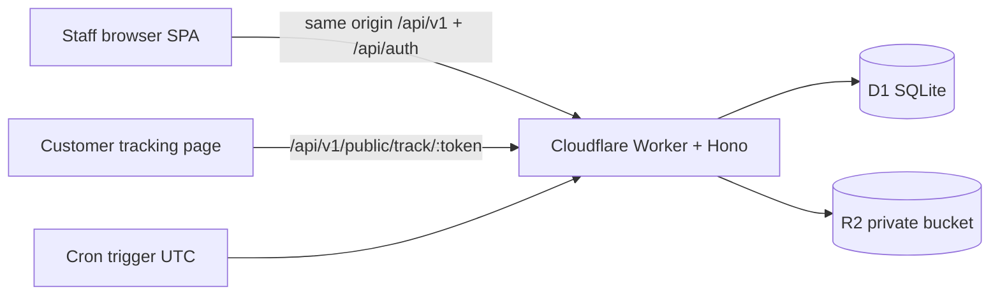

# Architecture

## Decisions

1. **Single-origin SPA + Worker** using `@cloudflare/vite-plugin` and Static Assets (`not_found_handling: single-page-application`, `run_worker_first: /api/*`). Avoids CORS/cookie split-brain.
2. **Better Auth + Drizzle/D1** for password hashing and HttpOnly sessions. Staff provisioning is admin-only; public signup disabled.
3. **SQL migrations in-repo** rather than only drizzle-kit push, so local `wrangler d1 migrations apply --local` is reproducible.
4. **Integer minor units + grams** for money/weight. Invoice total is an explicit field.
5. **One case owns bookings** in MVP. Multi-case vessel sharing is not implemented.
6. **Reminders** are recomputed on domain events and scanned by cron. Dedup key = `rule + entity + generation`.
7. **Uploads**: INIT/SIGN/COMPLETE/ABORT. If R2 S3 credentials exist, parts are presigned to R2. Otherwise local Worker part routes stream into the R2 binding multipart API.
8. **Single company**, not multi-tenant SaaS.

## Trade-offs

- Local upload path still touches the Worker per part. Parts are 8–20 MiB, not the whole 400 MiB object. Remote presign is required to keep 400 MiB off the Worker.
- In-memory public-link rate limit is per isolate. Staging should add KV/Durable Object limits.
- Bank account numbers are stored as last4 only until application encryption + key management is approved.
