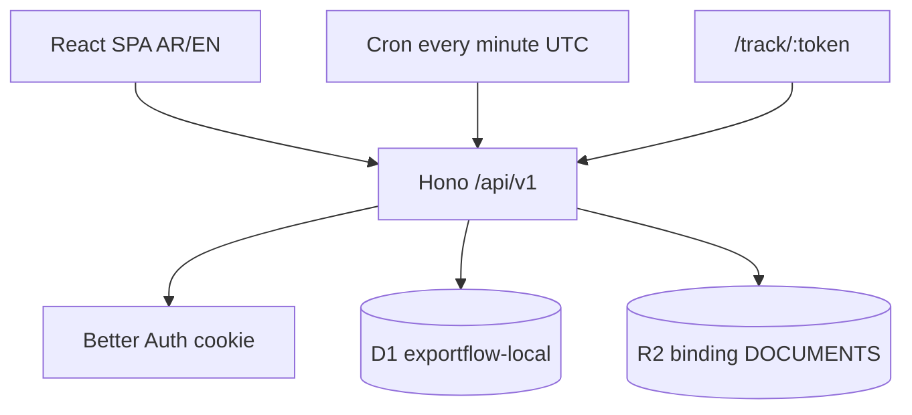

# Architecture reconciliation

Owner blueprint versus the code on 2026-10-13. Implemented behavior is the code, not older checkpoint prose.

## Runtime

`wrangler.jsonc` binds D1 `exportflow-local` with placeholder id `local-exportflow-not-a-remote-id` and bucket `exportflow-documents-local`. There is no `env.staging`. Remote migration script exits 1.

## Aggregate map

| Blueprint | Actual tables | Service | UI |
| --- | --- | --- | --- |
| Customer + contacts, addresses, bank last4 | `customers`, `customer_contacts`, `customer_addresses`, `customer_bank_accounts` | `customers.ts` | `CustomersPages.tsx` |
| Export case + snapshot | `export_cases`, `export_case_customer_snapshots` | `cases.ts` | `CasesPages.tsx` |
| Invoice, explicit total, grams | `export_invoices` | `cases.ts`, `domain/invoice.ts` | New case + invoice tab |
| Document checklist | `document_template_*`, `operation_document_requirements`, `document_versions` | `documents.ts` | Documents tab |
| Bank vs direct + manual courier | case path columns, `bank_submissions`, `courier_shipments` | `bank-courier.ts`, `domain/transitions.ts` | Bank and courier tabs |
| Booking slots, not equal to numbers | `bookings`, `containers`, `container_events` | `bookings.ts` | `OpsPages.tsx` |
| Reminders | `reminder_rules`, `reminder_instances`, `notification_deliveries` | `reminders.ts` | Reminders page |
| Public link hash | `tracking_links` | `tracking.ts` | Share tab, `TrackPage.tsx` |
| Custom fields | `custom_field_definitions`, `custom_field_values` | `custom-fields.ts` | Settings + entity panels |
| RBAC | `roles`, `role_permissions`, `user_permission_overrides` | `users.ts`, `actor.ts` | Users page |

## Request path

Browser `fetch` with cookies → Worker (`run_worker_first` for `/api/*`) → session load in `loadActor` → permission and, for case-owned rows, `assertCaseAccess` → service validation → D1 and optional R2 → `{ data, meta.requestId }` or `{ error.code, error.message, error.fieldErrors }`. The SPA maps `error.code` through `src/locales`.

## Gaps, not silent redesigns

- `MONEY` is listed in `shared/enums.ts` but rejected by the custom-field service. Money stays on invoice columns as minor units.
- Activity feed labels cover the known audit actions added this run. Unknown actions still use the generic fallback.
- CSV import preview now parses quotes in the browser. Commit is still a separate confirmed call.
- Local multipart upload is not proof of remote 400 MiB presign.
- `server/services/cases.ts` was empty on disk at the start of this run. It was restored from `dist/exportflow/assets/index-*.js` and then extended. The bundle did not yet include customer custom-field reads, so the restore followed the bundle for case/invoice behavior and the current `customers.ts` for customers.
