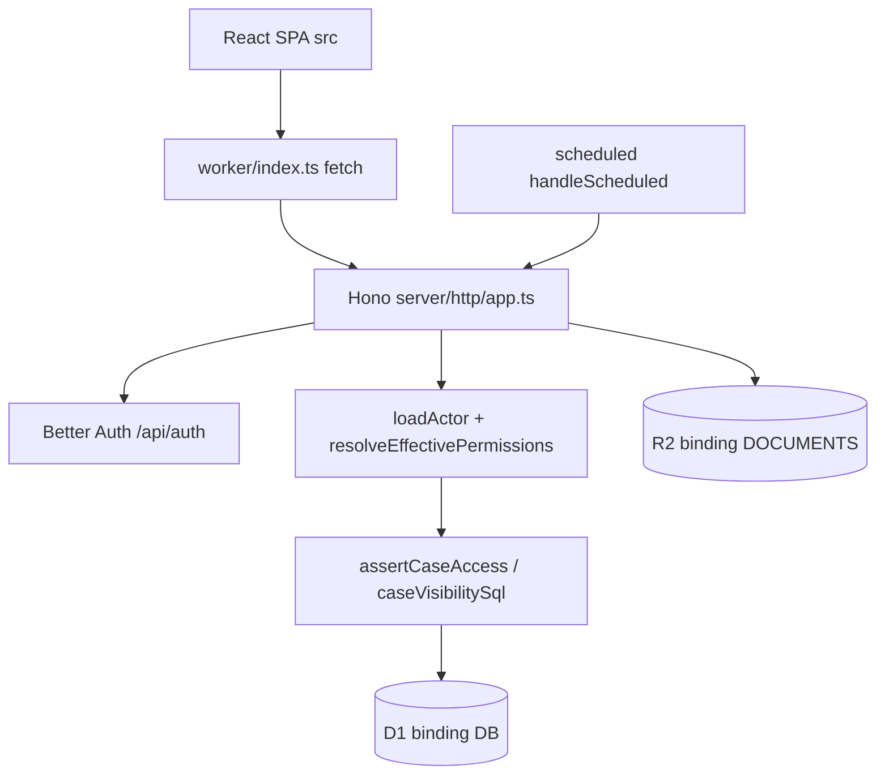

# المعمارية المُتحقَّق منها — Checkpoint 04

الحالة: ملاحظة من الكود الحالي. الحواف غير المُنفَّذة على Cloudflare معلّمة UNVERIFIED. لا تغيير إطار.

## دورة الطلب

`src/lib/api.ts` يرسل الكعكة. `run_worker_first` يوجّه `/api/*` إلى العامل. `loadActor` يقرأ الجلسة. `requirePermission` و`assertCaseAccess` على الخادم. الخطأ العام عبر `publicMessage` يخفي نص SQLite. الواجهة تترجم `error.code`.

## التخزين

الرفع: `createUploadSession` يتحقق من النوع والحجم والأب ثم `createMultipartUpload`. إن وُجدت مفاتيح R2 الأربعة يُعاد رابط موقّع (`R2_PRESIGNED`) وإلا مسار محلي `LOCAL_WORKER_PARTS`. الإكمال يطابق الحجم والبايتات السحرية. `authorizeObjectKey` يربط المفتاح بمتطلب أو حجز أو جلسة مكتملة ثم `assertCaseAccess`. رفض 403 يُعاد كـ 404 حتى لا يكشف وجود ملف عملية أخرى. المسار الموقّع إلى R2 الحقيقي **UNVERIFIED**. مفاتيح R2 غير موجودة في `.dev.vars` الحالي (الأسماء فقط في المثال).

## البيئات

`wrangler.jsonc`: D1 `exportflow-local` بمعرّف نائب `local-exportflow-not-a-remote-id`، دلو `exportflow-documents-local`، كرون `* * * * *`. لا `env.staging`. `db:migrate:remote` يخرج 1. E2E يحذف `.wrangler-e2e` فقط عبر `scripts/e2e-server.mjs`.

## فجوات موثّقة لا تُنفَّذ هنا

اقتراح ADR لاحق، بلا تنفيذ: إبقاء أسرار المعاينة خارج شجرة `dist` داخل الإضافة نفسها بدل الحذف اللاحق. لا استبدال لـ Hono أو D1 أو Better Auth.
